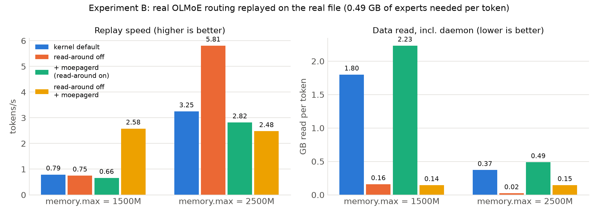
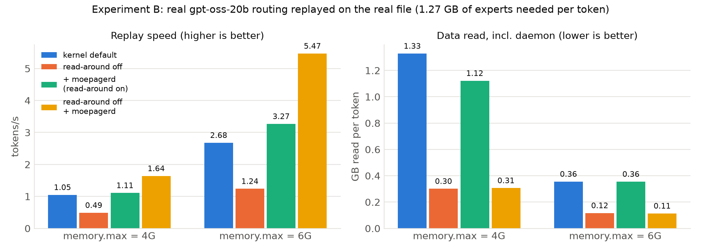

<header class="paper-title" markdown="1">
<p class="title">moepager: Expert-Aware Page-Cache Management for Mixture-of-Experts LLM Inference on Memory-Constrained Linux Machines</p>
<p class="authors">Shreshth Mishra · Ayush Sinha</p>
<p class="meta">Code, data and raw results: https://github.com/shreshth006/moepager</p>
<p class="meta"><em>Formal title:</em> System and Method for Non-Invasive, Expert-Aware Page-Cache Management for Mixture-of-Experts Model Inference on Memory-Constrained Linux Hosts</p>
</header>

<!-- BODY -->

<div class="abstract" markdown="1">
<b><i>Abstract</i>—</b>Mixture-of-Experts (MoE) language models activate only a few "expert"
sub-networks per layer for each token: 8 of 64 in OLMoE-1B-7B, 4 of 32 in
gpt-oss-20b, 8 of 128 in Qwen3-30B-A3B. That makes them attractive for
consumer machines, which run them with llama.cpp in `mmap` mode when the
model is larger than free RAM, leaving the Linux page cache to decide
which weights stay in memory.

We show that the kernel's generic behaviour fits this workload poorly:

- **Scattered units.** One expert's weights are three slices in three
    tensors hundreds of megabytes apart.
- **Read-around pollution.** On a page fault, the kernel reads a window
    around the faulting page: 4 MiB on our test machine's btrfs. That pulls
    unused neighbouring experts into the cache and multiplies SSD traffic
    3.7–4.8×.
- **Repacking.** llama.cpp's default CPU weight repacking moves 77–100 % of
    expert bytes into anonymous memory, outside the page cache.

We present **moepager**, a Rust toolchain and an unprivileged user-space
daemon that manage the shared page cache at the granularity of
(layer, expert) units, without changing the inference engine's code or
binary:

1. It parses the GGUF header into an exact expert map.
2. It observes expert misses black-box by polling sentinel pages with
      `mincore()`.
3. It answers each miss with **expert-completion readahead**: bulk
      `posix_fadvise(WILLNEED)` of the expert's remaining slices in 128 KiB
      chunks. The chunking is necessary because the kernel silently truncates
      larger requests.
4. A 64-line `LD_PRELOAD` shim turns off fault read-around on the model
      mapping, which no stock llama.cpp option does on single-node machines.

The evaluation toolchain records ground-truth routing from llama.cpp,
computes exact LRU miss-ratio curves, simulates policies against a Belady
optimum, and runs llama.cpp under cgroup memory limits.

On a 15 GB laptop running OLMoE-1B-7B (4.2 GB) under memory limits of
1.5 GB and 2.5 GB, moepager's configuration decoded **1.40 and 3.21
tokens/s**, versus 0.35 and 0.87 tokens/s for the same engine served by
the default page cache. That is **3.7–4.0× faster**, with **7–8× less SSD
traffic** and memory-pressure stall reduced from 12.7 % to 1.0 %. Default
llama.cpp, by contrast, was OOM-killed at both limits unless allowed to
spill 2.3–2.5 GB into compressed RAM swap. On a second model, gpt-oss-20b
(12.1 GB), replaying real routing under 4 GB and 6 GB limits showed the
same pattern: 1.6–2.0× faster than the kernel default, with 3–4× less
data read.

We also report what did not work: a value-based pinning policy captured
little of the optimal policy's 34–74 % miss reduction, and completion
readahead without turning off read-around made performance worse.

<p class="index-terms"><b><i>Index Terms</i>—</b>Mixture of experts, large language models, page cache, readahead, memory management, Linux, cgroups, llama.cpp.</p>
</div>

# 1. System Architecture

moepager is a **user-space control loop around the Linux page cache**. It
sits beside an unmodified inference engine, observes the engine only
through the page cache they share, and acts only through standard kernel
interfaces. Figure 1 shows the whole system; the subsections below define
its structure, components, interfaces, data model, runtime behaviour,
process and privilege model, and the design decisions behind them.


*Figure: moepager architecture (source: `docs/report/architecture.dot`; a portrait version is `architecture-portrait.png`).*

## 1.1 Architectural style

- **Layered, with ports and adapters.** Policy code is pure: it consumes
    observations and emits `Action` values, and never calls the kernel. All
    operating-system effects sit behind two traits (`PageCacheOps`,
    `ResidencyProbe`), with a Linux implementation and a mock one. This lets
    the same policy run in the simulator, in tests and in the daemon.
- **One core, two hosts.** The policy crate `mp-core` is linked both into
    the trace-driven simulator (`mp-sim`) and into the live daemon
    (`moepagerd`), so a policy evaluated offline is exactly the policy
    deployed (ADR 0001).
- **Three planes.**
    - An **offline plane** runs once per model file: it parses the header
        and builds the expert map.
    - An **online plane** is the observe → decide → act loop of the daemon.
    - An **evaluation plane** records ground truth, simulates policies
        against an optimal bound, and benchmarks under memory limits.
- **Non-invasive.** Nothing in the engine's source or binary is changed.
    The only intervention in the engine's process is an optional
    `LD_PRELOAD` shim that adds one `madvise` call after `mmap`.

The crate layers, from Cargo dependencies (each layer uses only layers
below it):

```
 L4  Front ends     moepager (CLI: gguf-map, synth, analyze, sim, record, replay, fault-io, …)
                    moepagerd (daemon)
 L3  Evaluation     mp-sim (simulator)   mp-analyze (reuse, MRC)   mp-synth (synthetic traces)
 L2  Policy core    mp-core: OnlineStats, CostModel, ResidencyEngine, Prefetcher -> Action
 L1  Adapters       mp-gguf (file format)   mp-recorder (observation)   mp-os (kernel calls)
 L0  Data           mp-trace (.mpt trace format, ExpertEvent)
 ----------------------------------------------------------------------------------------
     Linux 6.x: page cache, mincore, posix_fadvise, madvise, mlock, process_madvise,
                cgroup v2, PSI
```

## 1.2 Components and responsibilities

Table: Components of moepager and their responsibilities.

| Component | Language / size | Responsibility | Needs privilege |
|---|---|---|---|
| `mp-gguf` | Rust | Parse the GGUF header; build the expert map (units, slices, sentinels, page→unit index); report which tensors llama.cpp would repack | no |
| `mp-trace` | Rust | `.mpt` binary trace format; CSV import; token inference from layer order | no |
| `mp-os` | Rust | Kernel interfaces: `mincore`, `cachestat`, chunked `WILLNEED`, `MADV_POPULATE_READ` worker, `mlock`, `process_madvise`; `/proc` parsing (maps, smaps VmFlags, cgroup) | only for pin / demote |
| `mp-recorder` | Rust | Observation: sentinel polling, full residency scans, bpftrace event conversion, trace replay on a real file | bpftrace only |
| `mp-core` | Rust | Online statistics (decayed miss rates, layer transitions), cost model, V(e) residency planner, completion and predictive prefetch → `Action`s | no |
| `mp-sim` | Rust | Byte-capacity cache simulator with an I/O channel; evictors LRU, LFU, Belady\*; controllers wrapping `mp-core` | no |
| `mp-analyze` | Rust | Reuse distances (Fenwick tree), exact LRU miss-ratio curve, locality statistics | no |
| `moepagerd` | Rust | The daemon: event source → `mp-core` → `PageCacheOps`; start-up checks (read-around, cgroup, memlock limit) | optional |
| `moepager` | Rust | CLI front end for all offline and evaluation tasks | no |
| `libmoepager_preload.so` | C, 64 lines | `LD_PRELOAD` shim: `MADV_RANDOM` on read-only shared `*.gguf` mappings | no |
| `moe_trace` | C++, 169 lines | *Experiment only*: records ground-truth routing from llama.cpp's eval callback | no |
| `bench/` | Bash | Experiments A–D under cgroup v2 memory walls; metric snapshots | no (user systemd scope) |
| `python/moepager_tools` | Python | Result collection, report figures | no |
| llama.cpp [1] | external, unmodified | The inference engine; maps the model with `mmap` | no |

## 1.3 Interfaces

The boundaries between layers are four Rust traits and one value type:

```rust
/// mp-os: actuators on byte ranges of the model file (LinuxOps, MockOps).
pub trait PageCacheOps {
    fn prefetch(&mut self, offset: u64, len: u64) -> io::Result<()>; // async readahead
    fn pin(&mut self, offset: u64, len: u64) -> io::Result<()>;      // resident + unevictable
    fn unpin(&mut self, offset: u64, len: u64) -> io::Result<()>;
    fn demote(&mut self, offset: u64, len: u64) -> io::Result<()>;   // evict first
}

/// mp-os: residency queries (MappedFile via mincore, MockOps).
pub trait ResidencyProbe {
    fn resident(&self, first: u64, n: u64, out: &mut Vec<bool>) -> io::Result<()>;
    fn page_size(&self) -> u64;
}

/// moepagerd: where observations come from (SentinelSource, TraceSource).
pub trait EventSource {
    fn poll(&mut self) -> io::Result<Option<Vec<ExpertEvent>>>;
}

/// mp-core -> OS layer or simulated cache; units are dense ids l*E + e.
pub enum Action { Pin(u32), Unpin(u32), Prefetch(u32), Demote(u32) }

/// mp-sim: policy hooks driven by the simulator (StaticPin, VControl, ...).
pub trait Controller {
    fn on_access(&mut self, layer: u16, expert: u16, unit: u32, hit: bool, t_ns: u64);
    fn after_layer(&mut self, layer: u16, view: &View) -> Vec<Action>;
    fn end_token(&mut self, view: &View) -> Vec<Action>;
}
```

- The daemon is generic over `PageCacheOps` (`Daemon<O: PageCacheOps>`);
    `--ops mock` only logs actions, `--ops linux` executes them.
- An `Action` names a *unit*; the daemon expands it into the unit's slice
    byte ranges using the expert map, so policy code never sees offsets.
- In the simulator, controllers that model black-box observation must
    drop the `hit = true` calls themselves, which is how the miss-only
    regime is evaluated.
- External interfaces: the GGUF file format [2]; the kernel system
    calls and `/proc` files listed under `mp-os` [3]; cgroup v2
    control files [4]; the `.mpt` trace format
    (`docs/TRACE_FORMAT.md`); the expert map as JSON (`map.json`).

## 1.4 Data model

Table: Data model.

| Entity | Fields | Notes |
|---|---|---|
| `ExpertMap` | arch, page size, data offset, file size, `n_layers` L, `n_experts` E, top-k, `units`, `dense`, warnings | built once per file; serialisable as JSON |
| `Unit` | layer l, expert e, bytes s_u, `slices` | dense id u = l·E + e; 1,024 units for OLMoE, 6,144 for Qwen3-30B-A3B |
| `Slice` | kind (`up`, `gate`, `down`, `gate_up`, `*_bias`), tensor name, absolute offset, length | 32-byte aligned, so a page may belong to two units |
| `DenseRegion` | name, layer, offset, length | attention, norms, embeddings: everything that is not an expert |
| Sentinel | page index, (l, e), reliable flag | middle page of a weight slice, ≥ 128 KiB from its edges |
| `PageIndex` | sorted intervals + prefix-max of ends | page → `Owner::Expert{unit, slice}` or `Owner::Dense{region}` |
| `ExpertEvent` | `t_ns` u64, `token` u32, `layer` u16, `expert` u16 | 16-byte `.mpt` record; "used" (full) or "missed" (miss-only) |
| `.mpt` file | magic `MPTRACE\0`, version, record kind, JSON header (model, observation regime, units), fixed-size records | expert records (16 B) or page records (24 B) |
| `OnlineStats` | decayed counts and exposures per unit, layer-transition rows, layer time | the daemon's only state besides the pinned set |

## 1.5 Runtime data flow

For each decoded token, with the recommended configuration (engine with
`-nr` and the shim; daemon with `--policy v --budget-mb 0`):

1. The engine computes layer l and reads the k experts the router chose.
      Pages of the chosen units that are not resident cause page faults.
      Because of `MADV_RANDOM`, each fault reads only the faulting page.
2. The faulted page is inserted into the shared page cache. If it is a
      sentinel, the unit's sentinel flips from non-resident to resident.
3. Within one poll period (300 µs in the experiments), `SentinelSource`
      reports the flip as an `ExpertEvent` for (l, e).
4. `moepagerd` updates `OnlineStats` and infers token boundaries from the
      layer order.
5. The prefetcher returns `Action::Prefetch(u)`. `LinuxOps` issues
      `posix_fadvise(WILLNEED)` for every slice of u in 128 KiB chunks, and
      the kernel starts large asynchronous reads.
6. The engine's remaining faults on u are satisfied by pages that are
      already resident or already under I/O. They wait on the in-flight read
      instead of issuing their own small reads.
7. If a pin budget is set, every 4 tokens the residency planner may emit `Pin` / `Unpin` / `Demote` actions,
      which become `mlock` / `munlock` / `process_madvise(MADV_COLD)`.
8. Under the cgroup's `memory.max`, the kernel's reclaim (MGLRU [5])
      evicts unpinned pages as usual; the daemon never evicts by itself
      unless demotion is enabled.

Offline, `mp-gguf` produces the map used in steps 2–5. For evaluation,
`moe_trace` replaces steps 2–3 with exact router output, and `mp-sim`
replaces steps 1, 6 and 8 with a model of the cache and the I/O device.

## 1.6 Process, privilege and memory view

Table: Processes, model mappings and privileges at run time.

| Process | Runs | Maps the model | Privilege |
|---|---|---|---|
| Engine (`llama-cli`, `llama-bench`, …) | unmodified binary, optionally `LD_PRELOAD` shim | `MAP_SHARED`, `PROT_READ`, whole file | none |
| `moepagerd` | separate process, same user | `MAP_SHARED`, `PROT_READ`, whole file (for `mincore` and `mlock`) | none for observation and prefetch; `CAP_IPC_LOCK` for pinning; `CAP_SYS_NICE` for demotion of the engine's pages |

- **No copies.** Both processes map the same file, so they share the same
    page-cache folios. A page the daemon prefetches or pins is the page the
    engine reads.
- **One memory budget.** Both run in one cgroup v2 scope with a
    `memory.max` limit [4]. Page-cache pages are charged to the
    cgroup of the task that brought them in, so co-location makes the
    daemon's prefetches count against the same budget as the engine's
    faults (ADR 0008). The daemon warns when it is not in the engine's
    cgroup.
- **Start-up checks** (`--pid`): the engine's mapping must carry the `rr`
    (random-read) VmFlag in `/proc/<pid>/smaps`, otherwise read-around is
    still on; the memlock limit is compared with the pin budget.
- **Failure isolation.** If the daemon stops, the engine continues with
    plain kernel behaviour; every action is a hint, and pins are released
    when the daemon's mapping is closed.

## 1.7 Key design decisions

Table: Architecture decision records.

| ADR | Decision | Reason |
|---|---|---|
| 0001 | Policy core in Rust, shared by simulator and daemon | what is simulated is what runs |
| 0002 | Treat black-box observation as miss-only | hits are served by the MMU and are invisible to user space |
| 0003 | Residency via `mlock` pin + `MADV_COLD` demote, not `fadvise(DONTNEED)` | `DONTNEED` does not drop pages another process maps |
| 0004 | Measure (go/no-go, kill criteria) before building the live daemon | avoid optimising a cost that does not exist |
| 0005 | 128 KiB guard distance for sentinel pages | a neighbour's read-around must not trigger a sentinel |
| 0006 | Chunk `WILLNEED` into 128 KiB requests | the kernel silently truncates larger requests |
| 0007 | Require `--no-repack` / `-nr` for llama.cpp | repacked weights live in anonymous memory, outside the page cache |
| 0008 | Run daemon and engine in one cgroup | fair accounting of prefetched pages |
| 0009 | Two-tier observation: unprivileged sentinels, optional bpftrace | works without root; exact events when root is available |
| 0010 | Token boundaries from layer regression with a slack | the engine exposes no token signal |
| 0011 | Optional `LD_PRELOAD` shim to turn off read-around | no stock llama.cpp option does it on single-node machines |


# 2. Introduction and Problem Statement

## 2.1 Background

Mixture-of-Experts (MoE) language models [6, 7] replace each
dense feed-forward block with many smaller "expert" networks plus a
router. For every token,
the router picks a few experts per layer (top-k), so only a small fraction
of the parameters is used per token. In the three models studied here,
OLMoE [8], gpt-oss [9] and Qwen3 [10] (values read from
the real model file headers [11]):

Table: The three MoE models studied (values from the GGUF headers).

| Model | File (quantisation) | Size | Layers × experts | top-k | Expert share of file |
|---|---|---|---|---|---|
| OLMoE-1B-7B-0924 | Q4_K_M | 4.21 GB | 16 × 64 | 8 | 92.6 % |
| gpt-oss-20b | MXFP4 | 12.11 GB | 24 × 32 | 4 | 84.1 % |
| Qwen3-30B-A3B | Q4_K_M | 18.56 GB | 48 × 128 | 8 | 94.6 % |

Because only 4–8 experts per layer are touched per token, MoE models are an
attractive fit for consumer machines. A common way to run a model larger
than free RAM is llama.cpp [1] in `mmap` mode: the model file is mapped into
memory, and the Linux page cache loads weights on demand and evicts them
under memory pressure.

## 2.2 Problem statement

The kernel's page cache is generic. Its reclaim policy (MGLRU [5])
and its fault read-around [12] know nothing about how a GGUF file
[2] is laid out or how MoE
routing behaves. Our measurements on a 15 GB laptop (Section 6) show three
concrete problems:

1. **The unit of use is scattered.** One expert at one layer is stored as
      three slices in three different tensors (`ffn_up_exps`, `ffn_gate_exps`,
      `ffn_down_exps`), hundreds of megabytes apart. The kernel cannot know
      these three ranges belong together.
2. **Read-around pollutes the cache.** On a page fault, Linux reads a window
      around the faulting page: 4 MiB on this machine's btrfs filesystem. For
      expert slices of about 1–1.3 MB, most of that window belongs to
      neighbouring experts that will not be used. Replaying real OLMoE routing
      under a 1.5 GB budget, the SSD read **1.80 GB per token to deliver
      0.49 GB of needed expert weights** (3.7× amplification), and almost
      every expert access missed.
3. **Fault-driven reads are slow.** Faulting cold experts in through mmap
      delivered only 0.15–0.24 GB/s on the real model file. Reading the same
      bytes with large prefetch requests delivered 1.5–1.7 GB/s.

A further, practical problem: llama.cpp on x86 CPUs with AVX2 by default
*repacks* the most common quantised expert weights into ordinary
(anonymous) memory. That is 77 % of the expert bytes for OLMoE and Qwen3
Q4_K_M, and 100 % for gpt-oss MXFP4. Under memory pressure those pages go
to swap instead of the page cache.

**Goal:** make MoE inference faster on memory-constrained Linux machines,
using knowledge of the model file's structure and of routing behaviour,
**without modifying the inference engine** and without copying the
weights.

# 3. Literature Review and Objectives

## 3.1 Related work

**MoE offloading inside the inference engine.** Most systems that keep
only part of an MoE model in fast memory are built into the engine, where
the router's decisions are directly visible:

- mixtral-offloading (Eliseev and Mazur [13]): LRU expert cache
    plus speculative prefetch.
- MoE-Infinity (Xue et al. [14]): activation-aware expert cache.
- HOBBIT (Tang et al. [15]): mixed-precision experts, implemented as
    about 8,000 lines added to llama.cpp.
- Pre-gated MoE [16], DuoServe-MoE [17] and similar
    systems: predict next-layer experts and prefetch them. Liu et al.
    [18] survey this design space.

Inside llama.cpp itself there are several open proposals [19]:
PR #25294 (O_DIRECT expert streaming that bypasses the page cache),
PR #26824 (expert heat map and mmap pinning), PR #29887, issue #20757 and
discussion #27149. All of these modify the engine.

**Using the OS page cache as the expert tier.** Si et al. [20] is
the closest study. On a datacenter GH200 node they
show that kernel recency (LRU) serves about as much demand as an oracle
static-frequency pin, that Belady's bound [21] leaves about one third of LRU's
misses addressable, and that `fadvise(WILLNEED)` prefetch hints gained only
0.3–5 %. Their engine reads with `pread`, so mmap fault behaviour and file
structure play no role.

**Operating-system mechanisms.**

- cache_ext / cachebpf (Zussman et al. [22]) lets eBPF programs
    replace page-cache eviction, but needs a patched kernel.
- MGLRU [5] and DAMON [23] are generic and know nothing of model
    structure.
- vmtouch [24] pins or evicts file ranges given by the user.
- "LLM in a flash" (Alizadeh et al. [25]) bundles co-used
    weights so that flash reads are large. That is the same idea as our
    expert-completion readahead, but it is implemented inside the engine and
    requires reformatting the model. PowerInfer [26] similarly
    exploits activation locality inside the engine, keeping frequently
    activated ("hot") neurons in fast memory.

**Gap.** We found no system that manages the page cache for an
*unmodified* engine using the *model file's structure*, and none that
measures the effect of mmap fault read-around on MoE experts.

## 3.2 Objectives

- **O1.** Build an exact map from GGUF files to (layer, expert) units and
    their byte and page ranges, verified on real models.
- **O2.** Observe expert usage from outside the engine, without root.
- **O3.** Build an evaluation toolchain: ground-truth routing traces, trace
    analysis, a policy simulator with an optimal (Belady) bound, real-kernel
    replay, and benchmarks under a fixed memory budget.
- **O4.** Implement page-cache actuators: chunked readahead, pinning and
    demotion. Combine them in a daemon whose policy code is identical to the
    simulated one.
- **O5.** Decide go/no-go on real hardware with predefined kill criteria,
    and report only measured numbers.


# 4. Methodology and Algorithms

This section defines the problem formally (4.1), then describes each
algorithm in the order data flows through the system: the expert map
(4.2), black-box observation (4.3), read-around suppression (4.4),
expert-completion readahead (4.5), the optional residency policy (4.6) and
the offline evaluation algorithms (4.7). Sections 4.8–4.10 give the
experimental protocol, the metric definitions and the threats to validity.
Every algorithm below corresponds to code in the repository; the crate is
named in each heading.

## 4.1 Problem model and notation

Table: Notation.

| Symbol | Meaning |
|---|---|
| F, P | the GGUF model file; the page size (4 KiB on the test machine) |
| L, E, k | number of MoE layers, experts per layer, experts chosen per token per layer (top-k) |
| u = (l, e) | an expert **unit**: expert e of layer l; U is the set of all L·E units |
| S(u) | the slices of u: one byte range `[a, b)` of F per expert tensor (`up`, `gate`, `down`, optional bias rows) |
| s_u | size of unit u in bytes, Σ over S(u) of (b − a) |
| R_{t,l} | the k experts the router selects at decode step (token) t, layer l |
| σ | an access trace: the sequence of units R_{1,1}, R_{1,2}, …, R_{T,L} |
| C | the memory budget: cgroup v2 `memory.max` [4] |
| B_d, B_b | delivered bandwidth of fault-driven reads and of bulk readahead |
| t_f | fixed cost of one demand miss (fault entry plus first I/O latency) |

Decoding token t touches, layer by layer, every unit in R_{t,l} plus the
dense (non-expert) tensors of layer l. The engine maps F read-only and
shared, so every touched byte is served from the page cache, which holds
at most C bytes (minus the engine's anonymous memory). A unit access is a
**hit** if all its pages are resident and a **miss** otherwise.

The quantity to minimise is decode time per token. Under memory pressure
it is dominated by I/O stall, which a simple cost model captures:

        stall(miss of u)  =  t_f + s_u / B_d               (kernel default)
        stall(miss of u)  =  t_f + t_detect + s_u / B_b     (with completion readahead)

Two levers follow directly. **Residency** (which units stay cached)
reduces the number of misses. **Read path** (how a missing unit is read)
reduces the cost of each one. The original hypothesis was that residency
is the main lever; Section 6 shows that on an `mmap` engine the read path
dominates, because B_d is small and the kernel's read-around inflates the
bytes read per miss.

## 4.2 Expert map from the GGUF header (`mp-gguf`)

A GGUF file [2] starts with a header listing every tensor's name,
shape, ggml type and data offset. `mp-gguf` parses only this header, so a
truncated prefix of the file is enough. For each tensor named
`blk.<l>.ffn_{up,gate,down,gate_up}_exps.weight` with shape
`[ne0, ne1, E]`, the expert index is the outermost (slowest-varying)
dimension, so each expert's weights are contiguous inside the tensor:

```
Algorithm 1  BuildExpertMap(header)
  for each tensor T matching blk.<l>.ffn_*_exps.*:
      bytes  := type_size(T.type) * (ne0 * ne1 * E) / block_size(T.type)
      stride := bytes / E                       # warn if E does not divide bytes
      for e in 0 .. E-1:
          add slice [T.offset + e*stride, T.offset + (e+1)*stride) to unit (l, e)
  for each 2-D per-expert tensor ([ne0, E], e.g. *_exps.bias):
      add one row per expert to unit (l, e)
  sort all slices by offset; build page->unit interval index (below)
  for each slice: choose a sentinel page (Section 4.3)
```

- **Page → unit index.** Slices are 32-byte aligned rather than page
    aligned, so a boundary page can belong to two units. The index stores
    slices as intervals sorted by start, plus a prefix-maximum array of
    interval ends, so the owners of any page are found by binary search in
    O(log n + r), where r ≤ 2 is the number of owners.
- **Repacking check.** `mp-gguf` also reports which expert tensors
    llama.cpp's CPU backend would repack into anonymous memory, based on
    the quantisation type and the repack rules in the engine source
    [1]. On AVX2 this covers 77 % (Q4_K_M) to 100 % (MXFP4) of the
    expert bytes, so the engine must run with `--repack 0` / `-nr` for the
    weights to stay in the page cache.
- **Cost.** O(number of tensors) to parse, O(n log n) to sort the n slices
    (n = 3·L·E; 3,072 for OLMoE, 18,432 for Qwen3-30B-A3B).
- **Verification.** Fixture GGUF files with known layouts are checked
    slice by slice (kind, offset, length of every unit), the page index is
    checked against the slices, and the real headers of OLMoE-1B-7B
    [8], gpt-oss-20b [9] and Qwen3-30B-A3B [10] are checked
    for layer, expert and top-k counts and unit sizes.

## 4.3 Black-box observation by sentinel pages (`mp-recorder`)

The engine is a black box: the daemon cannot see router decisions. It
infers them from the page cache, which is shared.

**Sentinel choice.** For each slice, one page in its middle is chosen as
the **sentinel**, at least 128 KiB (`SENTINEL_GUARD`) from either edge of
the slice. A fault in a *neighbouring* slice brings in a read-around window
around the faulting page; with the default 128 KiB window, that window
cannot reach this sentinel. Slices shorter than 2 × 128 KiB + 2P are marked
unreliable, and bias rows (a few KiB, inside other tensors' pages) get no
sentinel. On btrfs the window is 4 MiB, larger than a whole OLMoE slice,
which is why read-around must be turned off (Section 4.4) for observation
to be correct as well as fast.

**Polling.** The daemon maps F read-only (`MAP_SHARED`, `PROT_READ`) and
calls `mincore(2)` [3] on the sentinel pages. This needs no
privilege and works for files the daemon does not own. (`cachestat(2)`
would need write access to the file.)

```
Algorithm 2  SentinelTick(sentinels, prev, now_ns)       # every Δ = 300 µs
  events := []
  for i, s in enumerate(sentinels):
      r := mincore(s.page)
      if r and not prev[i] and (s.layer, s.expert) not in events:
          events.append((now_ns, s.layer, s.expert))      # a miss of unit (l, e)
      prev[i] := r
  return events
```

- **Semantics.** A sentinel changing from non-resident to resident means
    "unit (l, e) has just been faulted in", which is a **miss**. Hits are
    invisible: pages already mapped are read through the CPU's page tables
    without entering the kernel, so no user-space interface reports them.
    All online statistics are therefore *miss-only* (ADR 0002).
- **Cost.** One `mincore` call per sentinel per sweep: O(3·L·E) system
    calls every Δ. The poll period Δ bounds detection latency to at most Δ
    plus the remaining sweep time.
- **False positives.** A sentinel can also turn resident because of the
    daemon's own prefetch of the same unit, or because read-around from an
    unrelated fault reached it. The first case is harmless (it re-issues a
    prefetch for a unit being read anyway). The second is eliminated by
    turning read-around off.
- **Privileged alternative.** With root, the same events can be taken
    exactly from the `filemap:mm_filemap_add_to_page_cache` tracepoint; a
    bpftrace script is included (ADR 0009). It was not used for the results.

**Token boundaries** are not visible either. Within one decode step layers
are visited in increasing order, so a new token is inferred when an event's
layer falls more than a slack (default 2 layers) below the highest layer
seen in the current step:

```
Algorithm 3  InferToken(event)                             # ADR 0010
  if max_layer is set and event.layer + slack < max_layer:
      end_token()                       # closes statistics, may trigger re-plan
  max_layer := max(max_layer, event.layer)
```

The slack absorbs reordering when several layers are discovered in the
same sweep. On ground-truth traces this recovers the true token count; on
miss-only traces a token whose misses are all in high layers can merge
with the previous one, which only affects the V(e) rate estimates.

## 4.4 Read-around suppression (`tools/preload`)

On a page fault in a file mapping, Linux reads a window of pages around
the faulting address ("read-around"), sized from the backing device's
`read_ahead_kb` (4 MiB for this machine's btrfs). For a 1–1.3 MB expert
slice, most of that window is neighbouring experts that will not be used.
The waste has two effects: up to 3.7–4.8× more SSD traffic than needed,
and a cache filled with unused pages, which raises the miss ratio.

Setting `MADV_RANDOM` on the mapping (`VM_RAND_READ` in the kernel)
disables read-around for it, so a fault reads exactly the faulting page.
Stock llama.cpp applies this only when `--numa` is set on a multi-node
machine. A 64-line `LD_PRELOAD` shim wraps `mmap()` and, for read-only
shared mappings of `*.gguf` files, calls `madvise(addr, len, MADV_RANDOM)`
after the original `mmap` returns (ADR 0011). The engine's code and binary
are unchanged. The daemon verifies the effect by checking for the `rr`
flag in the engine's `/proc/<pid>/smaps` VmFlags and warns if it is
missing.

Turning read-around off alone trades one problem for another: each miss
becomes hundreds of synchronous 4 KiB faults (39,000 per token in
Experiment B). Completion readahead (next section) turns them back into
bulk reads, but only for the unit that was actually chosen.

## 4.5 Expert-completion readahead (`moepagerd`, `mp-os`)

When a miss of unit u is observed, the daemon immediately asks the kernel
to read **all** of u asynchronously. The engine is typically still inside
the first slice (`up`); the `gate` and `down` slices, hundreds of
megabytes away in the file, arrive as large reads instead of thousands of
small faults.

```
Algorithm 4  OnMiss(u)                                     # mp-core::prefetch
  for each slice [a, b) in S(u):
      for c in a, a+128K, a+256K, ... < b:                  # chunked (ADR 0006)
          posix_fadvise(fd, c, min(128K, b - c), POSIX_FADV_WILLNEED)
  stats.observe(u, MISS)
```

- **Chunking.** A single `WILLNEED` is silently truncated by
    `force_page_cache_ra()` in `mm/readahead.c` [12] to
    max(`io_pages`, `ra_pages`) pages, so a 1 MiB request populated only
    256 KiB in our tests. Issuing 128 KiB chunks makes every byte requested
    actually read.
- **Asynchrony.** `WILLNEED` queues reads and returns, so the daemon never
    blocks on I/O. The alternative `MADV_POPULATE_READ`
    (`--prefetch-mode populate`) is synchronous and runs on a worker thread;
    it is for devices where readahead is disabled and `WILLNEED` has no
    effect.
- **Prediction-free.** The action is taken only for units the router has
    already chosen, so it never wastes bandwidth on wrong guesses. A
    cross-layer predictive variant (`--predict`) exists but is not
    recommended (Section 6).
- **Repeated misses.** Each unit has three sentinels, so one real miss can
    trigger up to three prefetches of the unit. A refractory window that
    suppressed repeats within 20 ms was evaluated and *doubled* misses
    (Phase 7 ablation: decode speed fell from 5.4 to 2.1 tok/s), because
    the repeats re-fetch pages reclaimed while the engine is still working
    through the unit. The window is therefore off by default.
- **Cost.** O(s_u / 128 KiB) system calls per miss, about 30 for an OLMoE
    unit; no data is copied, and the pages are shared with the engine.
- **Memory accounting.** Pages read on the daemon's behalf are charged to
    the daemon's cgroup. Daemon and engine are therefore run in the same
    cgroup (ADR 0008), so prefetching cannot exceed the budget C.

## 4.6 Residency policy V(e) (`mp-core`; optional, needs privilege)

With `CAP_IPC_LOCK` (or a raised `RLIMIT_MEMLOCK`), the daemon can pin
units with `mlock` through its own shared mapping, which pins the same
page-cache folios the engine reads. The policy chooses a pinned set
within a pin budget C_pin ≤ C by **value per byte**:

        V(u) = rate(u) · (t_f + s_u / B_d) / s_u

that is, the expected stall avoided per token per byte held. This is a
fractional-knapsack relaxation; the greedy order is optimal for the
relaxation and near-optimal when units are small compared with C_pin.

**Rate estimator under miss-only observation.** A pinned unit produces no
misses, so naive miss counts would make every pinned unit look cold.
rate(u) is instead defined as the **miss rate per token while unpinned**:

        rate(u) = (Σ_t w_t · miss_t(u) + p·k) / (Σ_{t: u unpinned at t} w_t + k)

- w_t = g^t with g = 2^{1/h} is an exponential decay weight with half-life
    h = 64 tokens, implemented by growing the weight of new events instead
    of shrinking old ones (O(1) per event, renormalised when w exceeds
    10^100).
- p is a prior rate and k = 0.05·w_t a light shrinkage, so a unit exposed
    for one token is not estimated at exactly 0 or 1.
- While a unit is pinned its estimate is frozen. At each re-plan a random
    2 % of pinned units are released ("exploration") so frozen estimates
    are refreshed.

```
Algorithm 5  Replan(stats, cost)                  # every 4 tokens (replan_every)
  excluded := random 2 % of pinned units          # exploration, miss-only only
  cand := [(V(u) * (1.25 if pinned[u] else 1), u) for u not excluded, V(u) > 0]
  sort cand by value descending                   # hysteresis factor 1.25
  want := {}; used := 0
  for (v, u) in cand:
      if used + s_u <= C_pin: want += u; used += s_u
  emit Unpin(u) [+ Demote(u)] for u pinned and not in want     # unpins first,
  emit Pin(u) for u in want and not pinned                     # so C_pin holds
```

- **Cost.** O(n log n) per re-plan for n = L·E units (1,024 for OLMoE),
    amortised over 4 tokens.
- **Hysteresis.** A pinned unit's value is multiplied by 1.25 when
    ranking, so a newcomer must beat it by 25 % to displace it. This bounds
    pin/unpin churn.
- **Demotion.** Units that leave the pinned set can be marked cold with
    `process_madvise(pidfd, MADV_COLD)` on the engine's mapping (needs
    `CAP_SYS_NICE`). `posix_fadvise(DONTNEED)` was rejected because it does
    not drop pages that another process has mapped (verified on Linux 6.19;
    ADR 0003).

The policy code is one Rust implementation used by both the simulator and
the daemon (ADR 0001), so simulated and live behaviour cannot drift apart.

## 4.7 Offline evaluation algorithms (`mp-sim`, `mp-analyze`)

**Trace-driven simulation.** `mp-sim` replays a trace σ against a cache of
C bytes:

- a hit costs nothing;
- a miss is queued on a single FIFO I/O channel and costs
    `t_f + s/B_d`, or `t_f + t_detect + s/B_b` with completion readahead;
- compute time per layer is taken from the trace timestamps;
- the reported quantities are miss ratio, bytes read, and modelled stall.

Policies compared: LRU (a stand-in for the kernel's MGLRU [5]), LFU,
prefix pinning, an oracle static-frequency pin, V(e) with full or
miss-only observation, predictive prefetch, and **Belady\***.

**Belady\*** evicts the cached unit whose next use is furthest in the
future [21]. For equal sizes this is optimal (MIN). With variable
sizes exact optimality is NP-hard, so the same rule is used as the
standard heuristic and labelled with an asterisk. Implementation: for
each unit, the sorted list of its positions in σ; the next use after
position i is found by binary search; cached units are kept in an ordered
set keyed by next use, so each access costs O(log N).

**Exact LRU miss-ratio curve.** `mp-analyze` computes, independently of
the simulator, the miss ratio of a byte-capacity LRU cache at *every*
capacity in one pass, using stack-distance analysis [27] with a
Fenwick tree [28]:

```
Algorithm 6  ByteReuseDistances(σ)
  fenwick := zeros(N)                      # one slot per trace position
  for i, u in enumerate(σ):
      if last[u] exists:
          D_i := fenwick.sum(last[u]+1 .. i-1)   # bytes of distinct units since last use
          fenwick.add(last[u], -s_u)
      else:
          D_i := infinity                        # cold miss
      fenwick.add(i, +s_u); last[u] := i
  # access i hits in LRU of capacity C  <=>  D_i + s_u <= C
  MRC(C) := |{ i : D_i + s_u > C }| / N         # sort thresholds once, O(N log N)
```

Each position holds the size of the unit whose *latest* access is there,
so a range sum counts each distinct unit once. The whole curve costs
O(N log N). The simulator's LRU agrees with this curve exactly at every
tested capacity; this cross-check between two independent
implementations is a regression test.

## 4.8 Experimental protocol

**Hypotheses and kill criteria.** The project was run as a go/no-go
experiment (ADR 0004) with criteria fixed before measuring (IDEA_REVIEW
§6):

- **K1:** Belady\* cannot save at least 15 % of misses relative to LRU at
    any realistic capacity → residency management is pointless.
- **K2:** fault-driven bandwidth is at least 0.75× bulk bandwidth → the
    read path is not worth changing.
- **K3:** default llama.cpp beats every page-cache configuration at equal
    memory → the approach has no user.

**Experiments.**

Table: Experiments A–D.

| | Question | Independent variables | Measured |
|---|---|---|---|
| **A** | How local and predictable is real routing; how much could any policy gain? | prompt domain (chat, code, prose); cache size 15–70 % of expert bytes; policy | reuse, concentration, next-layer recall; miss ratio per policy |
| **B** | What does the real kernel do with this access pattern? | memory budget (1.5, 2.5 GB); read-around on/off; daemon on/off | tokens/s, SSD bytes/token, major faults/token |
| **C** | How fast are fault-driven vs bulk reads of expert units? | read method (fault, WILLNEED one call, WILLNEED 128 KiB chunks, pread 1 MiB) | GB/s delivered, read amplification |
| **D** | Does it help a real engine end to end? | budget; configuration B0, B0S, B2, D2, P, PD | decode tokens/s, SSD bytes/token, faults/token, memory PSI |

- **A: ground truth.** `moe_trace`, a 170-line experiment-only program,
    records the router's choices through llama.cpp's scheduler eval
    callback by reading the `ffn_moe_topk-<l>` tensors row by row. Three
    prompts × 255 decode tokens give 32,640 unit uses per prompt for OLMoE
    (255 × 16 layers × top-8). The traces are then analysed
    (4.7) and simulated at seven capacities.
- **B: real-kernel replay.** `moepager replay` touches, for each token of
    the prose trace, every page of every chosen unit through `mmap` with 4
    threads (64 KiB chunks interleaved). It isolates the kernel's paging
    behaviour from the engine's compute.
- **C: bandwidth.** 32 cold, randomly chosen expert-sized ranges of the
    real file per method, 3 seeds, 8 threads.
- **D: end to end.** `llama-bench -p 0 -n 32 -r 3 -t 8 -lm mmap`
    [1]. Configurations: B0 default (repacking, zram swap allowed);
    B0S default without swap; B2 `--repack 0`; D2 B2 + moepagerd; P B2 +
    read-around off (shim); PD P + moepagerd.

**Controls applied to every run:**

- **Cold start:** the model's pages are dropped with
    `posix_fadvise(DONTNEED)` while no process maps it, followed by `sync`
    and a 5 s settle.
- **Memory wall:** each run executes in a transient cgroup v2 scope
    (`systemd-run --user --scope -p MemoryMax=C -p MemorySwapMax=0`)
    [4]. Swap is allowed only for B0 (`MemorySwapMax=infinity`).
    Daemon and engine share the scope.
- **Same binary, same file:** one llama.cpp build (commit 970b51c), one
    GGUF file per model, CPU only, 8 threads (`nproc` − 4).
- **Environment capture:** kernel version, CPU, free memory, filesystem
    type, every bdi's `read_ahead_kb`, MGLRU state and the llama.cpp commit
    are saved with each result set (`env.txt`).
- **Isolation of runs:** no test suite or build ran concurrently with
    measurements; one set of D runs that overlapped a test run was
    discarded and repeated.

## 4.9 Metric definitions

Table: Metric definitions.

| Metric | Definition | Source |
|---|---|---|
| tokens/s (D) | llama-bench `tg` mean ± standard deviation over repetitions | llama-bench output |
| tokens/s (B) | replayed tokens ÷ wall time | replay tool |
| SSD bytes / token (D) | (sectors read on the model's block device after − before) × 512 ÷ tokens; tokens = n_gen × reps + 1 (warm-up) | `/proc/diskstats` |
| Data read / token (B) | (`pgsteal` × 4 KiB + `file` at exit) ÷ tokens: page-cache inflow charged to the run's cgroup, including the daemon's reads | cgroup `memory.stat` |
| Major faults / token | D: `pgmajfault` of the cgroup ÷ tokens; B: the replayer's `ru_majflt` ÷ tokens | cgroup `memory.stat`, `getrusage` |
| Memory PSI | `some avg10` of the cgroup's `memory.pressure` at exit: share of the last 10 s in which at least one task stalled on memory [29] | cgroup |
| Read amplification | bytes read from storage ÷ expert bytes needed | C: `/proc/self/io` (single process, no daemon) |
| Miss ratio | misses ÷ unit accesses | simulator, MRC |
| Belady\* saving | 1 − misses(Belady\*) ÷ misses(LRU) at equal capacity | simulator |
| Next-layer recall | share of R_{t,l+1} contained in a size-k prediction made after layer l | `mp-analyze` |

Only measured numbers are reported. Where a configuration did not finish
(OOM kill, timeout), it is reported as such, never as zero or
extrapolated.

## 4.10 Threats to validity

- **Internal.**
    - A desktop session ran during the measurements; background activity
        adds noise, visible as run-to-run spread in some D configurations.
    - B uses one replay per variant; D uses 3 repetitions of 32 tokens.
        Differences below about 10 % should not be read as significant.
    - `/home` is btrfs with zstd compression, so device bytes can be lower
        than logical bytes. Quantised weights compress poorly, and the
        comparisons are between configurations on the same file.
    - Per-process I/O counters (`/proc/self/io`) do not include reads
        issued by another process. B's traffic is therefore taken from the
        cgroup (4.9); an earlier draft used the replayer's own counter and
        understated the daemon variants by 0.1–0.6 GB/token.
    - B0's swap device is zram, which is RAM. Its "fast" result uses memory
        outside the 1.5 / 2.5 GB budget, so it is reported separately.
- **Construct.**
    - The replay tool (B) touches pages but does not compute; it measures
        paging, not inference. D measures the real engine.
    - LRU in the simulator is an approximation of MGLRU [5]; B shows
        the kernel's behaviour directly.
    - Belady\* with variable sizes is a heuristic bound, not a proven
        optimum.
- **External.**
    - One machine, one SSD, one filesystem. Read-around on ext4 defaults to
        128 KiB, so the pollution effect, and the benefit of turning it off,
        will be smaller there.
    - End-to-end results exist for OLMoE only. gpt-oss-20b has A–C
        results; its D run was stopped because the B0 configuration exhausted
        system memory. Qwen3-30B-A3B was mapped from its header only.
    - Only llama.cpp's CPU backend was studied.
- **Conclusion.** The go/no-go decision depends on K1–K3 as defined
    before measuring; the unanticipated read-around finding is reported as
    such rather than folded into the original hypothesis.


# 5. Implementation

## 5.1 Technology stack and structure

Table: Technology stack.

| Layer | Choice | Why |
|---|---|---|
| Core, simulator, daemon, CLI | **Rust** (stable), 10 crates, ≈ 8,900 lines | Predictable latency for a daemon; fast enough for simulation sweeps; one language, so the daemon and the simulator share the *same* policy code |
| OS interface | `libc` syscalls behind traits (`PageCacheOps`, `ResidencyProbe`) | Real Linux implementation + `MockOps` for deterministic tests |
| Ground-truth capture | C++ against `libllama` (`tools/moe_trace`, 169 lines) | Needs the engine's eval callback; experiment-only |
| Read-around shim | C, `LD_PRELOAD` (`tools/preload`, 64 lines) | Disables fault read-around on the model mapping without touching the engine's code or binary |
| Privileged tracing | bpftrace script (26 lines) | Optional, root only |
| Fixtures, metric parsing, probes | Python (stdlib + pytest), 674 lines | Independent GGUF writer so parser tests aren't self-confirming |
| Experiments | Bash + cgroup v2 (`systemd-run --user`), no root | Fixed memory budget per run |
| CI | GitHub Actions: fmt, clippy `-D warnings`, tests, ruff, pytest, demo smoke run | |

Table: Rust crates and their responsibilities.

| Crate | Responsibility |
|---|---|
| `mp-gguf` | GGUF v2/v3 header parser, ggml type table, `ExpertMap`, page index, sentinels, repack-risk detection |
| `mp-trace` | `.mpt` binary trace format (spec in `docs/TRACE_FORMAT.md`), CSV import/export, token inference |
| `mp-core` | Deterministic RNG, cost model, `OnlineStats` (miss-only), `ResidencyEngine` (V(e)), `PrefetchPlanner` |
| `mp-synth` | Synthetic routing generator (skew, reuse, cross-layer affinity, drift) |
| `mp-analyze` | Fenwick-tree reuse distance, exact LRU miss-ratio curve, routing predictability, timing |
| `mp-sim` | Trace-driven cache + I/O-channel simulator, policies, Belady\* |
| `mp-os` | `mincore`, `cachestat`, chunked `fadvise`, `mlock`, `process_madvise`, `/proc/pid/maps`/`smaps` parsing |
| `mp-recorder` | Sentinel and full-scan recorders, page→expert conversion, bpftrace ingest, mmap/pread trace replayer |
| `moepager` | CLI: `gguf-map`, `synth`, `analyze`, `sim`, `import-csv`, `trace-csv`, `record`, `ingest-bpftrace`, `page2expert`, `replay`, `fault-io` |
| `moepagerd` | Daemon: policies `none`, `willneed-all`, `lru-pin`, `v`; sources `sentinel` / `trace:`; ops `linux` / `mock` |

## 5.2 Functional completeness

Table: Functional completeness.

| Feature | Status |
|---|---|
| GGUF expert map, verified on 3 real models | done, tested |
| Ground-truth routing capture + import | done, used on OLMoE |
| Trace analysis, simulator, Belady bound | done, tested, used |
| Unprivileged sentinel observation | done, tested end to end on real files |
| Chunked completion readahead | done, measured (Section 6) |
| Read-around shim | done, measured (Section 6) |
| V(e) pinning | implemented and unit-tested; live use needs `CAP_IPC_LOCK` (default memlock limit is 8 MB), **not measured** |
| `MADV_COLD` demotion | implemented; needs `CAP_SYS_NICE`, **not measured** |
| eBPF observation | script + ingest written; needs root, **not run** |
| Start-up checks: read-around still on, daemon outside the engine's cgroup | done, tested live |
| `MADV_POPULATE_READ` prefetch fallback (`--prefetch-mode populate`) | done, tested on a real file; not benchmarked |
| PSI-driven budget control, dashboard | future work |

## 5.3 Correctness

- **Tests:** 87 Rust and 13 Python tests, run in CI. They include:
    - parser checks against GGUF files written by an *independent* Python
        writer;
    - an assertion that simulated LRU equals the analytically computed LRU
        curve exactly;
    - a check that Belady\* never loses to any other policy;
    - real-kernel tests of `mincore`/`cachestat`/`fadvise`/`mlock` semantics
        on a real file;
    - end-to-end recorder tests that recover a replayed trace with 100 %
        recall;
    - daemon dry runs.
- **Real-model checks:**
    - The map of OLMoE/Qwen3/gpt-oss matches tensor sizes in the headers.
    - Each captured (token, layer) has exactly top-k experts.
    - The no-read-around replay reproduced the simulator's LRU prediction
        (Section 6.3).
- **Bugs found by testing and fixed:**
    - WILLNEED truncation (found by CI);
    - the btrfs device-number mismatch between `stat()` and `/proc/pid/maps`;
    - read-around/compression spill causing false expert detections;
    - duplicate completion prefetches (refractory window).

## 5.4 Demonstration

`make demo` runs the full pipeline with no model or root. It parses the
real Qwen3 map, generates routing, analyzes it, simulates policies, does a
daemon dry run, and records a replayed trace black-box. With a model,
`bench/phase7.sh` runs experiments A–D. Terminal screenshots of the tools
on the real OLMoE model follow.

## 5.5 Screenshots (real output on OLMoE-1B-7B)


*Figure: Expert map from the real GGUF header, with the repack warning for this AVX2 CPU.*


*Figure: Ground-truth routing capture through llama.cpp's eval callback.*


*Figure: Importing the routing trace and analyzing it: reuse, predictability, exact LRU curve.*


*Figure: Policy simulation, including the Belady\* bound.*


*Figure: Collected end-to-end results (B0S rows are OOM-killed runs), daemon counters, and the shim at work.*


*Figure: Test and lint status.*


# 6. Results and Performance Evaluation

## 6.1 Setup

Table: Experimental setup.

| Item | Value |
|---|---|
| Machine | Laptop, Intel i5-12450H (8 cores / 12 threads, AVX2), 15 GiB RAM + 8 GiB zram swap, desktop session running |
| Storage | Solidigm P41 Plus 512 GB NVMe (PCIe 4, QLC); `/home` is btrfs with `compress=zstd:1`; btrfs readahead window 4 MiB |
| OS | Fedora 42, Linux 6.19.14, MGLRU enabled |
| Engine | llama.cpp [1] commit 970b51c (2026-10-22), CPU only, 8 threads |
| Model | OLMoE-1B-7B-0924 [8] Q4_K_M (4.21 GB; 16 layers × 64 experts, top-8; experts 3.90 GB, units ≈ 3.8 MB) |
| Memory budget | cgroup v2 `memory.max` = 1.5 GB or 2.5 GB, swap off unless stated; daemon and engine in the same cgroup |
| Cold start | model evicted from the page cache before every run |

All numbers below are measured. Raw outputs are in
`bench/results/phase7-olmoe/` (logs, CSVs, cgroup statistics, journal
excerpts).

## 6.2 Experiment A: real routing, and how much any cache policy could gain

`moe_trace` recorded 255 decode tokens for each of three prompts: 32,640
expert uses per prompt. Measured properties:

Table: Locality and predictability of real OLMoE routing (Experiment A).

| Prompt | Same expert reused on the next token | Top-10 % experts' share of uses | Next-layer recall: transitions / popularity / previous token |
|---|---|---|---|
| chat | 41 % | 30 % | 0.60 / 0.36 / 0.42 |
| code | 48 % | 55 % | 0.78 / 0.66 / 0.48 |
| prose | 45 % | 38 % | 0.69 / 0.45 / 0.46 |

Routing is strongly local in time (41–48 % reuse) and predictable across
layers (60–78 % recall). The simulator was fed these traces with expert
caches of 15–70 % of the expert bytes. Miss ratios for the prose prompt
(other prompts in the CSVs):

Table: Simulated miss ratio by policy and cache size, OLMoE prose prompt (Experiment A).

| Cache size | LRU | LFU | V(e), miss-only | Belady\* (optimal) | Belady\* saves vs LRU |
|---|---|---|---|---|---|
| 15 % | 0.552 | 0.500 | 0.672 | 0.345 | 38 % |
| 25 % | 0.434 | 0.331 | 0.391 | 0.237 | 45 % |
| 35 % | 0.291 | 0.205 | 0.274 | 0.144 | 50 % |
| 50 % | 0.222 | 0.080 | 0.151 | 0.058 | 74 % |
| 70 % | 0.004 | 0.004 | 0.004 | 0.004 | 4 % |


*Figure: Simulated miss ratio versus cache size on real OLMoE routing (prose prompt).*

**Reading:**

- An optimal policy would avoid 34–74 % of LRU's misses at 15–50 %
    capacity across all three prompts, so kill criterion **K1 does not
    fire**.
- Our V(e) residency policy captures only part of that gap. It beats LRU
    at 25–50 % but is *worse* at 15 %.
- Plain LFU beats V(e) in most cells.

**Why V(e) lagged (pin-fraction sweep).** The default lets V(e) pin only
60 % of the cache and leaves the rest to LRU. With full observation and a
pin fraction of 0.95, V(e) matches LFU almost exactly: prose at 50 %, 0.081
vs 0.080; code at 15 %, 0.278 vs 0.276. Its ranking is sound.

The remaining gap is the **cost of black-box observation**. With misses
only, V(e) at 0.95 has 10–40 % more misses than with full observation in
most cells, and up to 2× in a few code-prompt cells (code at 25 %: 0.162 vs
0.075). That is exactly the information hidden from an unprivileged daemon,
because page-cache hits are invisible.

Pinning needs `CAP_IPC_LOCK`, so it was not used in the end-to-end runs.
Data: `bench/results/phase7-olmoe/pinfrac-sweep/`.

## 6.3 Experiment B: what the real kernel does (and simulator validation)

The prose trace was replayed on the real model file through `mmap`, with 4
threads touching each expert's pages, under the memory wall. The trace
needs 0.49 GB of expert data per token.

"Data read" is the page-cache inflow charged to the run's cgroup:
reclaimed pages (`pgsteal`) plus file pages still charged at exit
(Section 4.9). It includes the reads moepagerd issues on the engine's
behalf. An earlier version of this table used the replayer's own
`/proc/self/io`, which leaves out the daemon's reads and so understated
traffic for the two daemon variants; on the four daemon-free runs the two
counters agree to within 0.001 GB/token.

Table: Real-kernel replay of OLMoE routing under a memory limit (Experiment B).

| Budget | Variant | tokens/s | Data read / token (incl. daemon) | Major faults / token |
|---|---|---|---|---|
| 1.5 GB | kernel default | 0.79 | **1.80 GB** | 956 |
| 1.5 GB | read-around off (`MADV_RANDOM`) | 0.75 | **0.16 GB** | 38,802 |
| 1.5 GB | + moepagerd (read-around on) | 0.66 | 2.23 GB | 881 |
| 1.5 GB | **read-around off + moepagerd** | **2.58** | 0.15 GB | 12,342 |
| 2.5 GB | kernel default | 3.25 | 0.37 GB | 338 |
| 2.5 GB | read-around off | **5.81** | 0.02 GB | 5,704 |
| 2.5 GB | + moepagerd (read-around on) | 2.82 | 0.49 GB | 321 |
| 2.5 GB | read-around off + moepagerd | 2.48 | 0.15 GB | 12,641 |



*Figure: Experiment B: replay speed and data read per token for real OLMoE routing under two memory limits.*

**Reading:**

- **Read-around pollution dominates.** With the kernel's default 4 MiB
    read-around, the SSD read 1.80 GB per token at 1.5 GB to deliver
    0.49 GB, and nearly every expert access missed: neighbouring, unused
    experts filled the cache.
- **The simulator is validated once pollution is removed.** With
    read-around off, traffic fell 11× to 0.16 GB/token, which matches the
    simulator's LRU prediction for this capacity (0.14 GB/token, Section
    6.2).
- **Fewer bytes alone is not faster.** Read-around off produced 39,000
    small 4 KiB faults per token, so speed stayed at 0.75 tok/s.
- **moepagerd needs read-around off.** With read-around on, its sentinels
    fire on polluted pages and it made things slightly worse. With
    read-around off it turns the small faults into bulk reads: **3.3×
    faster** than the kernel default at 1.5 GB.
- At 2.5 GB, where most accesses already hit, read-around off alone was
    best in this replay; the daemon added overhead.

## 6.4 Experiment C: fault-driven vs bulk read bandwidth

32 cold expert units (3.8 MB each, three slices) of the real model file
were read in three ways, 3 seeds each:

Table: Cold expert-unit read bandwidth on the OLMoE file (Experiment C).

| Method | GB/s delivered | SSD bytes read ÷ needed |
|---|---|---|
| mmap page faults (8 threads) | 0.15–0.24 | 4.8× |
| WILLNEED, one call per slice | 0.97–1.42 | 1.00× |
| **WILLNEED, 128 KiB chunks** | **1.49–1.70** | **1.00×** |
| pread, 1 MiB blocks | 0.44–0.56 | 1.24× |


*Figure: Experiment C: delivered bandwidth and read amplification for cold OLMoE expert units.*

Bulk chunked readahead delivers expert bytes **≈ 7× faster** than page
faults, with no amplification, so kill criterion **K2 does not fire**.
Chunking matters: single calls are truncated by the kernel to the device
readahead size.

## 6.5 Experiment D: end to end with llama.cpp

`llama-bench` decoded 32 tokens × 3 repetitions (after a 1-token warmup)
inside the cgroup, starting cold. Decode throughput is mean ± standard
deviation over the 3 repetitions. SSD traffic and major faults are
cgroup/device totals divided by all 97 decoded tokens. PSI is the cgroup's
memory-pressure "some" average over the last 10 s at exit.

Table: llama.cpp decode under a cgroup memory limit, OLMoE-1B-7B (Experiment D).

| Budget | Configuration | tokens/s | SSD GB / token | Major faults / token | Memory PSI (some, avg10) |
|---|---|---|---|---|---|
| 1.5 GB | B0 default llama.cpp (repack; zram swap allowed) | 3.17 ± 0.26 | 0.31 | 38,206 | 16.2 % |
| 1.5 GB | B0S default llama.cpp, no swap | **OOM-killed** | — | — | — |
| 1.5 GB | B2 `--repack 0` (page cache, kernel only) | 0.35 ± 0.01 | 2.87 | 2,112 | 12.7 % |
| 1.5 GB | D2 B2 + moepagerd | 0.44 ± 0.02 | 2.90 | 871 | 4.8 % |
| 1.5 GB | P B2 + read-around off (shim) | 0.74 ± 0.07 | 0.25 | 50,418 | 18.1 % |
| 1.5 GB | **PD B2 + read-around off + moepagerd** | **1.40 ± 0.22** | 0.34 | 23,902 | **1.0 %** |
| 2.5 GB | B0 default llama.cpp (repack; zram swap allowed) | 7.89 ± 1.37 | 0.13 | 13,854 | 12.0 % |
| 2.5 GB | B0S default llama.cpp, no swap | **OOM-killed** | — | — | — |
| 2.5 GB | B2 `--repack 0` | 0.87 ± 0.02 | 1.19 | 1,402 | 14.8 % |
| 2.5 GB | D2 B2 + moepagerd | 1.25 ± 0.04 | 1.01 | 515 | 12.3 % |
| 2.5 GB | P B2 + read-around off | 2.51 ± 0.51 | 0.10 | 14,497 | 4.5 % |
| 2.5 GB | **PD B2 + read-around off + moepagerd** | **3.21 ± 0.65** | 0.17 | 8,161 | 2.5 % |


*Figure: Experiment D: llama.cpp decode throughput per configuration under two memory limits (mean ± s.d.).*

**Against the same engine serving weights from the page cache (B2):**

- PD is **4.0× faster at 1.5 GB** and **3.7× faster at 2.5 GB**.
- PD reads **8.4× and 7.0× fewer bytes from the SSD** per token.
- PD cuts memory-pressure stall (PSI) from 12.7 % to 1.0 % at 1.5 GB.
    This matters for other applications on the machine.

**Splitting the gain:**

- Turning read-around off accounts for 2.1–2.9×.
- moepagerd's completion readahead adds a further 1.9× (1.5 GB) and 1.3×
    (2.5 GB) on top.
- moepagerd *without* read-around off (D2) helps only 1.3–1.4×.

**Variability:** PD at 2.5 GB was measured in three independent sessions:
3.30 (1 repetition), 5.42 ± 1.07 and 3.21 ± 0.65 tok/s. The table reports
the last.

**Against default llama.cpp (B0):**

- B0 is faster (3.17 and 7.89 tok/s), but it gets there by pushing **2.5 GB
    and 2.3 GB of repacked weights into zram**, compressed swap that lives in
    RAM and is not counted against `memory.max` (journal: "1.4G memory peak,
    2.5G memory swap peak"). It therefore used far more than the budget.
- With swap disabled, so it is held to the same budget (B0S), default
    llama.cpp was **OOM-killed at both budgets**: it cannot run at all.
- moepager's configuration runs inside the budget.

A fair speed comparison against default llama.cpp therefore needs a
machine whose swap is on disk, or a budget that includes zram. That is
future work.

**Ablation (refractory window):** suppressing repeated completion requests
for 20 ms looked like an obvious efficiency fix, but it doubled misses and
cut PD at 2.5 GB from 3.21–5.42 to 1.09–2.05 tok/s. The repeats re-fetch
pages reclaimed while the engine is still working through an expert. The
window is therefore off by default.

## 6.6 Second model: gpt-oss-20b (experiments A–C)

The same pipeline was run on gpt-oss-20b MXFP4: 12.1 GB file, 24 layers ×
32 experts, top-4, 13.25 MB per expert unit. Memory limits were 4 GB and
6 GB, and routing was recorded for 3 prompts × 128 tokens. Raw data:
`bench/results/phase7-gptoss/`.

**Experiment D did not run.** Its first configuration, default llama.cpp,
repacks 100 % of gpt-oss's expert bytes (≈ 10 GB) into anonymous memory and
swaps them to zram, which lives in RAM. The machine ran critically low on
memory and the run was stopped. This is itself evidence of the problem
moepager avoids, but there are no end-to-end gpt-oss numbers.

- **Routing (A):** 40–47 % token-to-token reuse, next-layer recall 0.54–0.62
    versus 0.39–0.46 for popularity. Belady\* saves 44–67 % of LRU's misses
    at 15–50 % capacity, similar to OLMoE.
- **Bandwidth (C), 13.25 MB units:**

    Table: Cold expert-unit read bandwidth on gpt-oss-20b, 13.25 MB units (Experiment C).

    | Method | GB/s | Amplification |
    |---|---|---|
    | mmap faults | 0.14–0.44 | ≈ 2.5× |
    | WILLNEED, 128 KiB chunks | 1.44–1.88 | 1.00× |
    | WILLNEED, one call per slice | 0.93–1.10 | 1.44×, truncated |
    | pread | 0.31–0.65 | — |

- **Replay (B), prose trace, 1.27 GB of experts per token:**

Table: Real-kernel replay of gpt-oss-20b routing (Experiment B).

| Budget | Variant | tokens/s | Data read / token (incl. daemon) |
|---|---|---|---|
| 4 GB | kernel default | 1.05 | 1.33 GB |
| 4 GB | read-around off | 0.49 | 0.30 GB |
| 4 GB | + moepagerd (read-around on) | 1.11 | 1.12 GB |
| 4 GB | **read-around off + moepagerd** | **1.64** | **0.31 GB** |
| 6 GB | kernel default | 2.68 | 0.36 GB |
| 6 GB | read-around off | 1.24 | 0.12 GB |
| 6 GB | + moepagerd (read-around on) | 3.27 | 0.36 GB |
| 6 GB | **read-around off + moepagerd** | **5.47** | **0.11 GB** |



*Figure: Experiment B on gpt-oss-20b: replay speed and data read per token.*

**Reading:**

- The best configuration is the same as for OLMoE: read-around off plus
    completion readahead, **1.6× and 2.0× faster** than the kernel default,
    with **3–4× less data read** (0.31 vs 1.33 and 0.11 vs 0.36 GB/token).
- Two differences from OLMoE:
    - gpt-oss's expert slices (4.4 MB) are about as large as the read-around
        window, so read-around wastes less (≈ 1.05× at 4 GB).
    - Read-around off *alone* is slower than the default here, because 4 KiB
        faults replace useful large reads.
- moepagerd turns those small faults back into bulk reads, and also helps
    somewhat on its own with read-around on (1.06× and 1.22×).

## 6.7 Comparison with expected outcomes and with existing methods

Table: Expected versus measured outcomes.

| Expectation (IDEA_REVIEW, before measuring) | Outcome |
|---|---|
| Smarter eviction/pinning is the main lever (≥ 15 % fewer misses possible, K1) | The gap exists (Belady\* saves 34–74 % vs LRU), but our online V(e) policy did not capture it reliably, and pinning needs privileges. **Not the main lever.** |
| Bulk readahead beats fault-driven reads (K2) | Confirmed: ≈ 7× (Exp. C). |
| Default llama.cpp is beaten (K3) | Only at equal memory, where it OOMs. With zram it is faster. **Partially.** |
| (not anticipated) | Fault read-around pollution is the dominant cost: 3.7–4.8× read amplification. Turning it off is required for both correctness of black-box detection and speed. |

**Relation to existing methods:**

- Si et al. [20] found that `fadvise` lookahead hints gain ≤ 5 % on a GH200
    with a `pread`-based engine. Our result differs because on an
    mmap-based engine the problem is *how* missing experts are read (small
    synchronous faults plus large wasted read-around), not *which* experts
    to keep. Completion readahead attacks exactly that.
- In-engine systems (MoE-Infinity [14], HOBBIT [15], llama.cpp
    PR #25294 [19]) see router
    decisions directly and can avoid the issue entirely. moepager reaches a
    3.7–4.0× improvement over the stock page-cache path without modifying
    the engine's code or binary, at the cost of one `LD_PRELOAD` hint.

## 6.8 Go / no-go decision

**GO, with narrowed scope** (recorded in PHASES.md):

- The product is "read-around off + expert-completion readahead",
    validated end to end.
- V(e) pinning and predictive prefetch are demoted to research options.
- The next phase must validate on a second machine with disk swap and
    ext4, and on a larger model.


# 7. Conclusion

## 7.1 Summary

We built moepager, a toolchain and daemon that manages the Linux page cache
for Mixture-of-Experts inference using the model file's structure, without
changing the inference engine's code.

The project was run as an experiment with kill criteria fixed in advance.
On a real model (OLMoE-1B-7B) on a 15 GB laptop, the outcome was:

- **Go on the mechanism, no-go on the original emphasis.** We expected
    smarter *eviction* to be the main lever. Measurement showed the dominant
    cost under memory pressure is the kernel's fault **read-around**. On this
    machine's btrfs it read 3.7× more data than needed and filled the cache
    with unused neighbouring experts.
- **What works:**
    - turning read-around off for the model mapping, with a 64-line
        `LD_PRELOAD` shim, since no stock llama.cpp option does this on
        single-node machines;
    - plus moepagerd's expert-completion readahead in 128 KiB chunks.

    Together they turn tens of thousands of 4 KiB faults per token into bulk
    reads. See Section 6.5 for the end-to-end numbers.
- **What doesn't (yet):**
    - Completion readahead *without* turning read-around off made things
        worse.
    - Our V(e) pinning policy only matched LFU when allowed to pin most of
        the cache. With black-box (miss-only) observation it still loses
        10–40 % in most cells, up to 2×, and it needs extra privileges.
    - Default llama.cpp is faster than every page-cache configuration
        *if* it may spill 2.3–2.5 GB of repacked weights into zram (compressed
        RAM). Without swap it is OOM-killed at both budgets.
- **Smaller findings with independent value:**
    - The kernel silently truncates `WILLNEED`.
    - llama.cpp's default repacking moves 77–100 % of expert bytes out of
        the page cache.
    - llama.cpp's `--lazy-mode` keeps weights in anonymous memory.
    - btrfs reports different device numbers in `stat()` and
        `/proc/pid/maps`.

## 7.2 Limitations

- One machine, one filesystem (btrfs with a 4 MiB readahead window).
    End-to-end llama.cpp numbers exist only for OLMoE. gpt-oss-20b was
    evaluated with real routing, replay and the bandwidth benchmark, but its
    llama-bench run was stopped for low system memory. Qwen3-30B was only
    mapped from its header.
- Short runs (32 decode tokens × 3 repetitions in llama-bench); some
    configurations show large run-to-run spread.
- A desktop session was running during measurements.
- Pinning (`mlock`), demotion (`MADV_COLD`) and eBPF observation are
    implemented but untested, because they need privileges.
- The shim is still an intervention in the engine's process, although it
    doesn't change its code or binary.

## 7.3 Future work

1. Upstream: propose a llama.cpp option to apply `MADV_RANDOM` to expert
      tensors on single-node machines, which would remove the need for the
      shim.
2. Repeat on ext4 (128 KiB readahead) and on the larger models, with
      longer runs.
3. Evaluate pinning end to end with `CAP_IPC_LOCK` and a pin budget near
      90 % of the expert cache. Narrow the miss-only gap with privileged hit
      observation (DAMON [23]) where available.
4. Add a fallback when WILLNEED is ineffective (`MADV_POPULATE_READ`), and
      PSI-driven [29] control of the memory budget to protect other
      applications.

# 8. References

References are numbered in order of first citation. arXiv identifiers
are given for every preprint; where a peer-reviewed version is known, its
venue is listed first.

<div class="refs" markdown="1">

[1] ggml-org, "llama.cpp: LLM inference in C/C++," source code, commit 970b51c (Oct. 2026); files `src/llama-mmap.cpp`, `src/llama-model-loader.cpp`, `ggml/src/ggml-cpu/repack.cpp`. [Online]. Available: https://github.com/ggml-org/llama.cpp

[2] ggml-org, "GGUF," file format specification, `docs/gguf.md` in the ggml repository. [Online]. Available: https://github.com/ggml-org/ggml/blob/master/docs/gguf.md

[3] The Linux man-pages project, `mincore(2)`, `posix_fadvise(2)`, `madvise(2)`, `process_madvise(2)`, `mlock(2)`, `cachestat(2)`. [Online]. Available: https://man7.org/linux/man-pages/

[4] The Linux Kernel Documentation, "Control Group v2." [Online]. Available: https://docs.kernel.org/admin-guide/cgroup-v2.html

[5] The Linux Kernel Documentation, "Multi-Gen LRU." [Online]. Available: https://docs.kernel.org/admin-guide/mm/multigen_lru.html

[6] N. Shazeer, A. Mirhoseini, K. Maziarz, A. Davis, Q. Le, G. Hinton, and J. Dean, "Outrageously large neural networks: The sparsely-gated mixture-of-experts layer," in *Proc. Int. Conf. Learning Representations (ICLR)*, 2017, arXiv:1701.06538.

[7] W. Fedus, B. Zoph, and N. Shazeer, "Switch Transformers: Scaling to trillion parameter models with simple and efficient sparsity," *J. Mach. Learn. Res.*, vol. 23, no. 120, pp. 1–39, 2022, arXiv:2101.03961.

[8] N. Muennighoff *et al.*, "OLMoE: Open mixture-of-experts language models," arXiv:2409.02060, 2024.

[9] OpenAI, "gpt-oss-120b & gpt-oss-20b model card," arXiv:2508.10925, 2025.

[10] A. Yang *et al.*, "Qwen3 technical report," arXiv:2505.09388, 2025.

[11] Model files on Hugging Face: allenai/OLMoE-1B-7B-0924-GGUF, ggml-org/gpt-oss-20b-GGUF, unsloth/Qwen3-30B-A3B-GGUF. [Online]. Available: https://huggingface.co

[12] Linux kernel source, v6.19: `mm/readahead.c` (`force_page_cache_ra`, `page_cache_sync_ra`), `mm/filemap.c` (fault read-around), `include/trace/events/filemap.h`. [Online]. Available: https://git.kernel.org

[13] A. Eliseev and D. Mazur, "Fast inference of mixture-of-experts language models with offloading," arXiv:2312.17238, 2023.

[14] L. Xue, Y. Fu, Z. Lu, L. Mai, and M. Marina, "MoE-Infinity: Efficient MoE inference on personal machines with sparsity-aware expert cache," arXiv:2401.14361, 2024.

[15] P. Tang, J. Liu, X. Hou, Y. Pu, J. Wang, P.-A. Heng, C. Li, and M. Guo, "HOBBIT: A mixed precision expert offloading system for fast MoE inference," arXiv:2411.01433, 2024.

[16] R. Hwang, J. Wei, S. Cao, C. Hwang, X. Tang, T. Cao, and M. Yang, "Pre-gated MoE: An algorithm-system co-design for fast and scalable mixture-of-expert inference," arXiv:2308.12066, 2023.

[17] Y. Zhang, G. Pinkert, N. Yang, Y. Li, and D. Yuan, "DuoServe-MoE: Dual-phase expert prefetch and caching for LLM inference QoS assurance," arXiv:2509.07379, 2025.

[18] J. Liu, P. Tang, W. Wang, Y. Ren, X. Hou, P.-A. Heng, M. Guo, and C. Li, "A survey on inference optimization techniques for mixture of experts models," *ACM Comput. Surv.*, 2026, doi:10.1145/3794845, arXiv:2412.14219.

[19] ggml-org/llama.cpp, pull requests #25294, #26824, #29887 and #29250, issue #20757, discussion #27149. [Online]. Available: https://github.com/ggml-org/llama.cpp

[20] Y. Si, Y. Lin, D. Li, and J. Zhang, "Who should own the expert cache? Kernel-managed tiering for trillion-parameter MoE inference," arXiv:2608.12103, 2026.

[21] L. A. Belady, "A study of replacement algorithms for a virtual-storage computer," *IBM Syst. J.*, vol. 5, no. 2, pp. 78–101, 1966.

[22] T. Zussman, I. Zarkadas, J. Carin, A. Cheng, H. Franke, J. Pfefferle, and A. Cidon, "Cache is king: Smart page eviction with eBPF," arXiv:2502.02750, 2025.

[23] The Linux Kernel Documentation, "DAMON: Data Access MONitor." [Online]. Available: https://docs.kernel.org/admin-guide/mm/damon/index.html

[24] D. Hoyte, "vmtouch: the Virtual Memory Toucher," source code. [Online]. Available: https://github.com/hoytech/vmtouch

[25] K. Alizadeh, I. Mirzadeh, D. Belenko, K. Khatamifard, M. Cho, C. C. Del Mundo, M. Rastegari, and M. Farajtabar, "LLM in a flash: Efficient large language model inference with limited memory," in *Proc. 62nd Annu. Meeting Assoc. Comput. Linguistics (ACL)*, 2024, arXiv:2312.11514.

[26] Y. Song, Z. Mi, H. Xie, and H. Chen, "PowerInfer: Fast large language model serving with a consumer-grade GPU," in *Proc. ACM SIGOPS 30th Symp. Operating Systems Principles (SOSP)*, 2024, arXiv:2312.12456.

[27] R. L. Mattson, J. Gecsei, D. R. Slutz, and I. L. Traiger, "Evaluation techniques for storage hierarchies," *IBM Syst. J.*, vol. 9, no. 2, pp. 78–117, 1970.

[28] P. M. Fenwick, "A new data structure for cumulative frequency tables," *Softw.: Pract. Exper.*, vol. 24, no. 3, pp. 327–336, 1994.

[29] The Linux Kernel Documentation, "PSI — Pressure Stall Information." [Online]. Available: https://docs.kernel.org/accounting/psi.html

</div>
